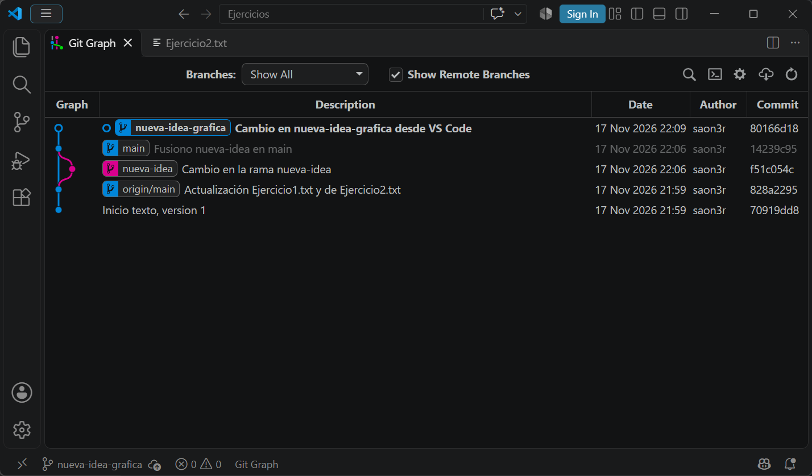
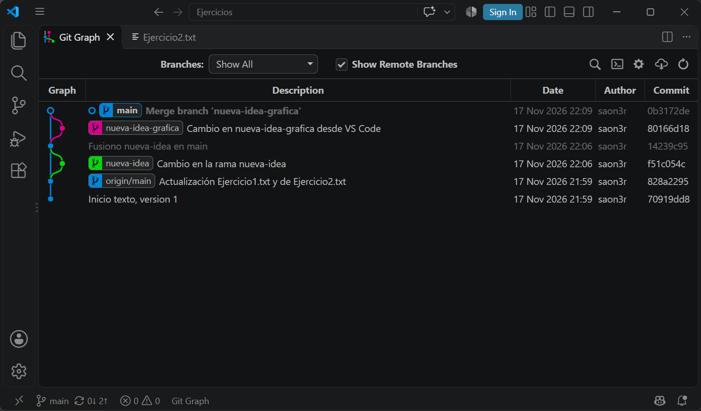

# Prácticas de Git y ramas

La práctica de ramas continúa los dos commits de la práctica inicial de Git. En el primero se añadió solo `Ejercicio1.txt` y en el segundo se actualizó ese archivo y se incorporó `Ejercicio2.txt`.

## 1. Ramas desde la terminal

Al ejecutar `git branch nueva-idea`, la nueva rama apareció en la lista y el asterisco siguió en `main`. Al cambiar a `nueva-idea`, los archivos tenían el mismo contenido porque las dos ramas apuntaban al mismo commit.

Añadí a `Ejercicio1.txt` un consejo sobre dónde colocar el router. `git status --short` mostró ` M Ejercicio1.txt`. Después de preparar el archivo con `git add Ejercicio1.txt`, lo guardé en el commit [`f51c054`](https://github.com/saon3r/FHARD-GIT1/commit/f51c054).

Al volver a `main` comprobé que la frase todavía no aparecía. Ejecuté `git merge --no-ff nueva-idea` y comprobé que la frase ya estaba en `main`. Usé `--no-ff` para dejar un [commit de fusión](https://github.com/saon3r/FHARD-GIT1/commit/14239c9) con dos padres, de modo que se pueda seguir el recorrido de ambas ramas en el gráfico.

## 2. Ramas con Git Graph en VS Code

1. En Git Graph abrí el menú contextual del commit al que apuntaba `main`, elegí **Create Branch…** y creé `nueva-idea-grafica` con **Check out** activado. La barra inferior de VS Code mostró la rama activa.
2. Añadí una frase a `Ejercicio2.txt`. Desde **Source Control** preparé el archivo con **+** y pulsé **Commit**. En Git Graph apareció [`80166d1`](https://github.com/saon3r/FHARD-GIT1/commit/80166d1) en `nueva-idea-grafica`, mientras `main` seguía en el commit anterior.
3. Usé **Checkout Branch** sobre `main` y comprobé que la frase aún no estaba en el archivo. Abrí el menú de `nueva-idea-grafica`, seleccioné **Merge into current branch…** y mantuve activada la opción que crea un commit aunque sea posible un avance rápido. El [commit de fusión](https://github.com/saon3r/FHARD-GIT1/commit/0b3172d) incorporó la frase a `main`.

### Antes de fusionar

### Después de fusionar

## Prueba adicional de conflicto

En un repositorio local de prueba cambié la misma línea de `router.txt` en dos ramas. Una proponía una ubicación elevada y la otra una ubicación central. Al fusionar, Git marcó el archivo como `UU router.txt` y dejó las dos versiones entre los marcadores `<<<<<<<`, `=======` y `>>>>>>>`.

Resolví el conflicto conservando ambas ideas en una sola frase, «Coloca el router en una zona central, elevada y despejada.». Después ejecuté `git add router.txt` y confirmé la fusión. El directorio de trabajo quedó limpio.
